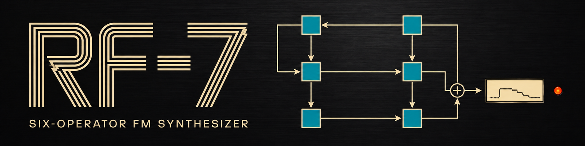

# RF-7

RF-7 is a 16-voice FM synth for RackForge. Each voice has six sine operators and one of 32 algorithms. An operator can be heard directly as a carrier or change the sound of another operator as a modulator. The algorithm determines how they connect.

## Install

RF-7 is included in the RackForge Standard bundle. To install it separately, download `RF-7.rfplugin` and choose **Install plugin** in RackForge's **Plugin Manager**. [Download RF-7](https://github.com/kalexis1994/RF-7/releases/latest)

## Play a program

Open **RF-7** in PLAY and choose from 38 original factory voices. Try **RF BRASS**, then play it softly and firmly. Use **Brightness** to change how strongly the modulators color the sound, **Envelope Time** to change its timing and **Velocity Depth** to adjust how much it responds to your touch.

## Make a sound of your own

1. Choose **Edit** to work from the current voice or **New program** to start fresh.
2. Change a modulator's level to hear how the sound gains or loses harmonics. Change its frequency ratio to move between related overtones and more metallic sounds.
3. Adjust the operator envelopes to shape the attack and tail. Use **Compare** to audition the original while editing, then save your version as a user program. [Voice editing guide](docs/EDITING.md)

## Install a cartridge

In **CONFIG**, choose a cartridge bay and select **Install…**. RF-7 reads compatible DX7 SysEx voice and bank files, as well as supported cartridge images and ZIP collections. Open the installed bank in PLAY to browse its voices. [Cartridge guide](docs/CARTRIDGES.md)

## License

RF-7 is distributed under GPL-3.0-only. [License](LICENSE) · [Notices](NOTICE.md)
